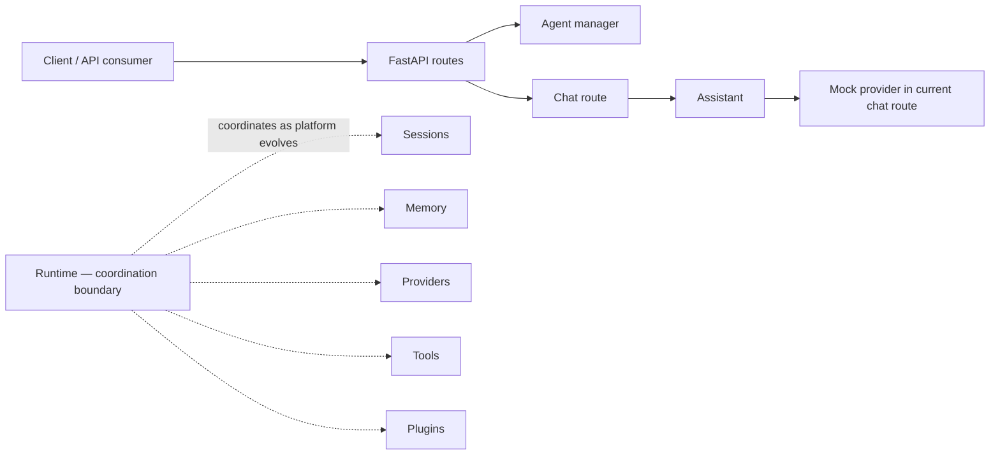
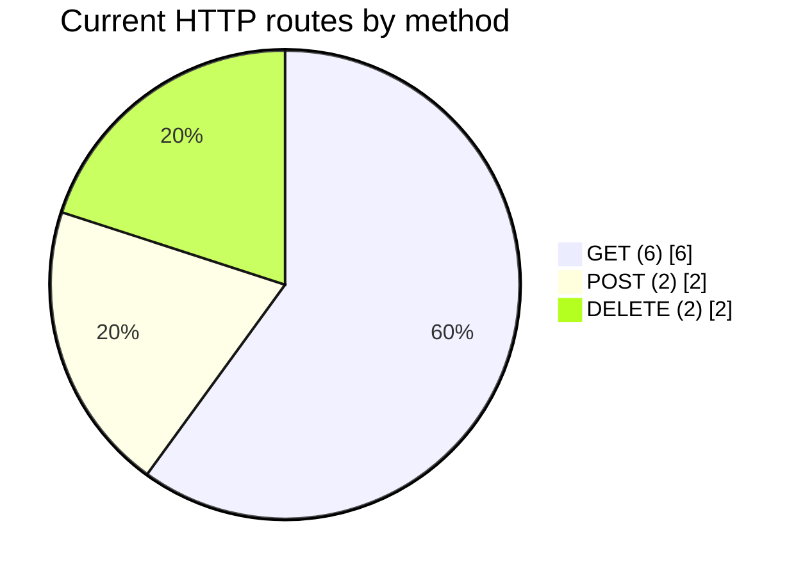

<div align="center">

# ✨ AI Agent Platform

### A modular Python foundation for building, running, and extending AI assistants.

[](https://www.python.org/)
[](LICENSE)
[](https://github.com/cupidnavaz/ai-agent-platform/stargazers)
[](https://github.com/cupidnavaz/ai-agent-platform/commits/main)
[](https://github.com/cupidnavaz/ai-agent-platform/issues)

[Explore the API](#-api-at-a-glance) · [Get started](#-quickstart) · [Architecture](#-how-it-fits-together) · [Roadmap](#-project-status)

</div>

---

> **Project status: early alpha.** This repository is an actively evolving platform foundation. The current HTTP chat endpoint uses a mock provider; production model integrations and other capabilities described by the project vision should not be assumed to be implemented yet. See [what works today](#-what-works-today) and [project status](#-project-status).

<details>
<summary><strong>🧭 Contents</strong></summary>

- [At a glance](#-at-a-glance)
- [What works today](#-what-works-today)
- [Feature cards](#-feature-cards)
- [How it fits together](#-how-it-fits-together)
- [Quickstart](#-quickstart)
- [API at a glance](#-api-at-a-glance)
- [Interactive API docs](#-interactive-api-docs)
- [Project layout](#-project-layout)
- [Configuration and operations](#-configuration-and-operations)
- [Development](#-development)
- [Project status](#-project-status)
- [Contributing](#-contributing)
- [License](#-license)

</details>

## 📊 At a glance

| Project card | Current snapshot |
|---|---|
| **Purpose** | Modular framework for AI assistants and autonomous-agent applications |
| **Language** | Python |
| **Python requirement** | 3.13 or newer |
| **HTTP framework** | FastAPI + Uvicorn |
| **API docs** | FastAPI-generated OpenAPI and Swagger UI |
| **License** | MIT |
| **Maturity** | Alpha; interfaces and capabilities may change |

The badges above are live GitHub widgets: repository activity, stars, issues, and license details update automatically. They are repository metadata—not uptime, performance, or product-readiness guarantees.

## ✅ What works today

The checked items below describe functionality visible in the current repository, rather than the broader long-term platform vision.

- **FastAPI application** with root, health, and version routes.
- **Agent management API** to list, create, retrieve, and delete agents.
- **Chat API** to send a message, inspect in-memory conversation history, and clear that history.
- **Mock chat provider** wired into the current chat route so the HTTP flow can be exercised without model credentials.
- **Modular Python package** organized around agents, providers, runtime, sessions, memory, tools, plugins, routes, and related platform concerns.
- **Automated interactive API reference** generated by FastAPI (Swagger UI and ReDoc).

### Feature maturity

| Capability | Status in this repository |
|---|---|
| FastAPI service and basic health/version routes | Implemented |
| Agent CRUD endpoints | Implemented |
| Chat endpoint and history controls | Implemented; current route uses `MockProvider` |
| Real external LLM provider integrations | Not confirmed by the current chat route; do not assume production model access |
| Persistent conversation history | Not provided by the current in-memory chat route |
| RAG, orchestration, enterprise deployment | Part of the wider product vision; verify implementation before relying on it |

## 🧩 Feature cards

<table>
<tr>
<td width="50%">
<h3>🧠 Agent management</h3>
Create named agents, attach a description, list the current agents, retrieve one by name, or delete it through the HTTP API.
</td>
<td width="50%">
<h3>💬 Chat foundation</h3>
Send a message through a small HTTP interface. The current endpoint is backed by a mock provider and returns a reply with the assistant's conversation history managed in-process.
</td>
</tr>
<tr>
<td width="50%">
<h3>🧱 Modular architecture</h3>
The codebase separates API routes and platform domains, making it easier to evolve components independently as implementation grows.
</td>
<td width="50%">
<h3>📚 API explorer</h3>
FastAPI exposes an interactive Swagger UI and a ReDoc reference while the service is running—use them to discover and try available endpoints.
</td>
</tr>
<tr>
<td width="50%">
<h3>🩺 Service visibility</h3>
Use the health and version endpoints for basic service checks and deployment probes. These are simple application responses, not a complete observability system.
</td>
<td width="50%">
<h3>🔌 Extensible direction</h3>
Providers, tools, memory, sessions, and plugins are core architectural concepts. Their presence in the design does not imply every integration is production-ready today.
</td>
</tr>
</table>

## 🏗️ How it fits together

The intended design uses the **runtime as a coordinator** between platform components, instead of coupling every subsystem directly to every other subsystem.



### Current HTTP endpoint mix

A small chart generated by GitHub Mermaid summarizes the **10 routes currently defined** in the application: six GET, two POST, and two DELETE routes.



This is an endpoint inventory, not a traffic, latency, success-rate, or uptime chart.

## 🚀 Quickstart

### Requirements

- Python **3.13+**
- `pip`

### Install and run

```bash
git clone https://github.com/cupidnavaz/ai-agent-platform.git
cd ai-agent-platform

python -m venv .venv
# macOS / Linux
source .venv/bin/activate
# Windows PowerShell: .venv\Scripts\Activate.ps1

python -m pip install --upgrade pip
python -m pip install -e .
uvicorn app.main:app --reload
```

The server starts at <http://127.0.0.1:8000>.

### Try it

Open <http://127.0.0.1:8000/docs> for interactive Swagger UI, or <http://127.0.0.1:8000/redoc> for ReDoc. You can also check the basic service routes:

```bash
curl http://127.0.0.1:8000/health
curl http://127.0.0.1:8000/version
```

Create and list an agent:

```bash
curl -X POST http://127.0.0.1:8000/agents/ \
  -H 'Content-Type: application/json' \
  -d '{"name":"helper","description":"A demo assistant"}'

curl http://127.0.0.1:8000/agents/
```

Send a chat message:

```bash
curl -X POST http://127.0.0.1:8000/chat/ \
  -H 'Content-Type: application/json' \
  -d '{"message":"Hello!"}'
```

> The chat route currently uses `MockProvider`; the example demonstrates the API flow and is not a connection to a hosted LLM.

## 🔌 API at a glance

| Method | Path | Purpose |
|---|---|---|
| `GET` | `/` | Service name and version |
| `GET` | `/health` | Basic health response |
| `GET` | `/version` | Application version |
| `GET` | `/agents/` | List agents |
| `POST` | `/agents/` | Create an agent (`name`, optional `description`) |
| `GET` | `/agents/{name}` | Retrieve an agent by name |
| `DELETE` | `/agents/{name}` | Delete an agent by name |
| `POST` | `/chat/` | Send a message (`message`) and receive a reply |
| `GET` | `/chat/history` | Read current assistant chat history |
| `DELETE` | `/chat/history` | Clear current assistant chat history |

The agent manager reports invalid creation requests as `400` and missing agents as `404`. The route schemas are also available in the running service's OpenAPI document at `/openapi.json`.

### Interactive API docs

Once the server is running, choose an endpoint in Swagger UI, expand it, select **Try it out**, enter a request body if required, and select **Execute**. FastAPI also publishes the machine-readable OpenAPI schema at `/openapi.json` and a ReDoc view at `/redoc`.

## 🗂️ Project layout

```text
app/
├── agents/       # Assistant and agent management
├── cli/          # Command-line package area
├── commands/     # Command package area
├── config/       # Configuration package area
├── container/    # Container / dependency package area
├── core/         # Core settings, logging, and version modules
├── memory/       # Memory package area
├── plugins/      # Plugin package area
├── prompts/      # Prompt package area
├── providers/    # Model-provider abstractions and implementations
├── routes/       # FastAPI HTTP routes (agents and chat)
├── runtime/      # Runtime package area
├── sessions/     # Session package area
├── storage/      # Storage package area
├── tools/        # Tool package area
└── main.py       # FastAPI application entry point

tests/            # Automated test package and component test modules
docs/             # Feature, development, and design documentation
```

This tree is a high-level guide; a directory or module name alone is not a promise of a complete integration. Start at `app/main.py` and the relevant route or component to verify current behavior.

## ⚙️ Configuration and operations

- **Logging:** the application configures logging using `settings.log_level` during startup.
- **Health check:** `GET /health` returns a basic healthy status while the application process can serve the route.
- **Version check:** `GET /version` returns the application version.
- **Chat state:** the current chat assistant is instantiated in the route module; its history is in memory and is cleared by `DELETE /chat/history`.
- **Secrets and providers:** no real provider credentials are needed for the current mock-backed chat route. Follow provider-specific documentation if integrating an external model; never commit secrets.

For deployment, add and validate the production requirements that fit your environment (for example, durable storage, authentication, rate limiting, secret management, observability, and provider configuration). The basic health endpoint should not be treated as a full readiness check for external dependencies.

## 🧪 Development

Install the project in editable mode as shown above, then run the test suite with:

```bash
python -m pytest
```

If `pytest` is not present in your environment, install it before running tests. Consult [CONTRIBUTING.md](CONTRIBUTING.md) and the [engineering guide](ENGINEERING_GUIDE.md) for repository-specific contribution and workflow guidance.

Useful project references:

- [Architecture](ARCHITECTURE.md)
- [Getting started](docs/getting_started.md)
- [API documentation](docs/api.md)
- [Agents](docs/agents.md)
- [Providers](docs/providers.md)
- [Tools](docs/tools.md)
- [Memory](docs/memory.md)
- [Sessions](docs/sessions.md)
- [Plugins](docs/plugins.md)
- [Roadmap](ROADMAP.md)
- [Changelog](CHANGELOG.md)
- [Engineering guide](ENGINEERING_GUIDE.md)

## 🛣️ Project status

This project is under active development. The repository documentation describes a broader modular agent platform vision; the live code currently exposes a compact FastAPI service, basic agent management, and mock-backed chat. The chart and capability cards above intentionally describe the current API and distinguish architecture direction from verified behavior.

Before building on a capability, check its module, tests, and linked documentation. Expect alpha interfaces and implementation scope to evolve.

## 🤝 Contributing

Issues, ideas, and pull requests are welcome. Please review [CONTRIBUTING.md](CONTRIBUTING.md) before opening a change, and include tests or clear reproduction steps when applicable.

## 📄 License

Distributed under the [MIT License](LICENSE).

---

<div align="center">

**Build thoughtfully. Keep agents modular. Make capabilities explicit.**

</div>
